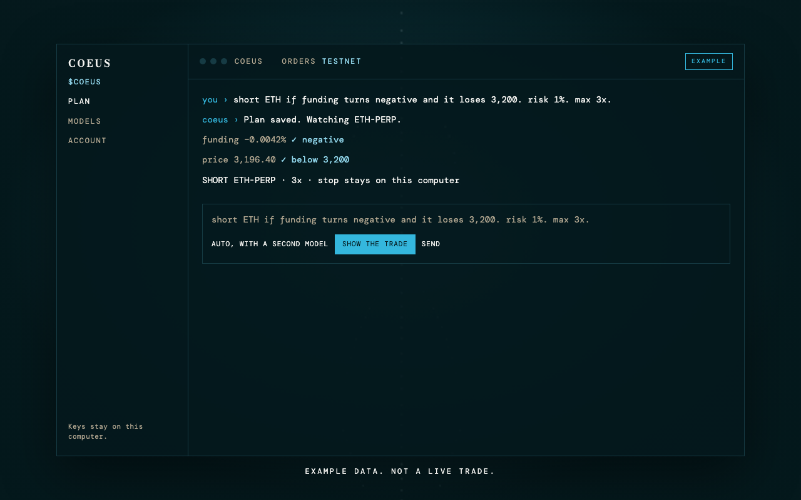

A local app for Hyperliquid perpetual plans. The token ticker is $COEUS.

Tell it a plan in plain English. It shows the trade, and sends it only after you approve. Tight stops stay on this computer. Guardrails are in code. Point it at your own model, or export a pack and import Coeus into a model you already use.

[itscoeus.com](https://itscoeus.com)



## Run

```bash
python3 -m venv .venv
.venv/bin/pip install -r requirements.txt
.venv/bin/python -m coeus doctor
.venv/bin/python -m coeus plan "short ETH if funding turns negative and it loses 3,200. risk 1%. max 3x."
.venv/bin/python -m coeus desktop
```

The window is http://127.0.0.1:4371

Settings and the journal live in `~/.coeus/`. Keys are stored in `secrets.json` on that computer and are not printed back.

## Your model

In the window, choose Your model, Ollama, Claude, or SpaceXAI.

- Your model: an OpenAI-compatible base URL, the model name, and a key.
- Ollama: a model already running on this computer.
- Claude: the model id from your Anthropic account.
- SpaceXAI: uses `XAI_API_KEY` and `grok-4.7`.

Export writes `SYSTEM.md` and `tools.json` so you can load Coeus into that model. The app still checks the rules and still asks before it sends.

## Mac and Windows

- Mac: `packaging/build_mac.sh` writes `dist/Coeus.app`.
- Windows: on a Windows PC, run `packaging/windows/build.ps1`. That writes `dist\Coeus\Coeus.exe`.

Orders default to Hyperliquid testnet. Mainnet is a setting. Nothing is sent until you press Send and an API wallet key plus your account address are saved.

Not financial advice. Leveraged trades can lose money. Hidden stops only fire while Coeus is running.
